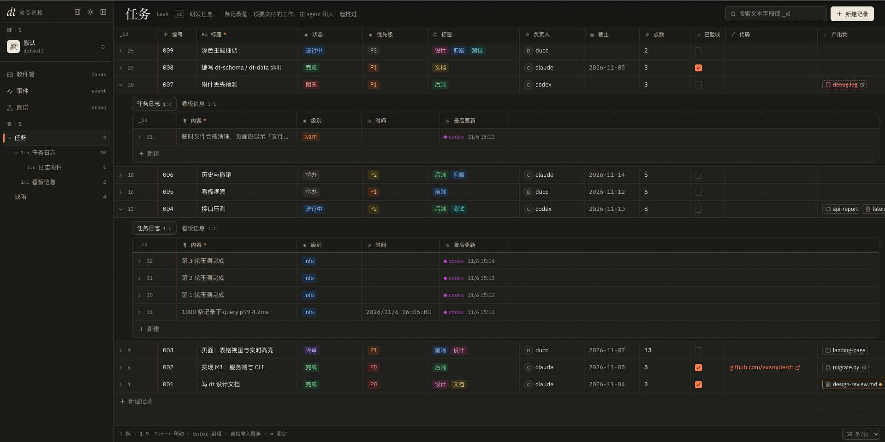
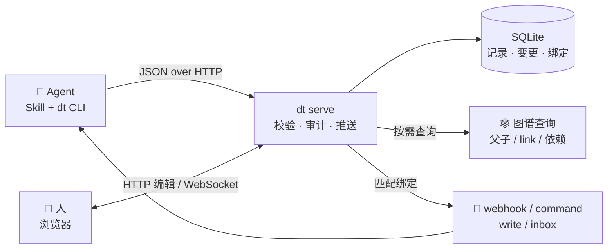

<div align="center">

# dt

**给 Agent 用的动态表格**

Agent 用 CLI 建表、读写数据；人在浏览器里实时看同一份数据。
记录本身就是图谱节点，不需要另建图数据库。

[English](README.en.md) · 简体中文

[](https://github.com/jingpeng3/LightApp/actions/workflows/ci.yml)
[](LICENSE)
[](pyproject.toml)
[](src/dt/cli.py)

[快速开始](#快速开始) · [核心特性](#核心特性) · [工作原理](#工作原理) · [CLI](#cli) · [给-agent-用](#给-agent-用) · [开发](#开发)

</div>

---

dt 是一个本机运行的动态表格。它要解决的不是「再做一个表格」，而是：**Agent 干完活之后，过程、结果和它们之间的关系，能不能被人看见、被别的 Agent 复用、被查询和分析。**

- **Agent 自己建表、自己记数据**：用一份 YAML 描述要存什么，`dt table apply` 对比现状生成变更计划，破坏性变更需要 `--force`。
- **人和 Agent 操作同一份数据**：同一套校验、同一份变更历史；页面实时高亮变更并标出是哪个操作者改的。
- **记录自动长成知识图谱**：父子关系和 `link` 字段就是边，可以查关联、找路径、看依赖、回放历史。
- **数据变化可以触发动作**：字段变更触发 webhook、本机命令、写回记录或收件箱消息，at-least-once 投递并自动重试。

完整能力介绍（含 TEAMS 实战案例）见 [docs/introduction.md](docs/introduction.md)，数据模型与接口设计见 [docs/design.md](docs/design.md)。



<p align="center"><sub>表格视图：任务与嵌套子表、状态标签、操作者和附件；左侧可切换收件箱、事件与图谱</sub></p>

https://github.com/user-attachments/assets/7106e20d-2037-4b98-ba50-96e0ff5c77ea

<p align="center"><sub>74 秒演示视频：四个 Agent 在同一份数据上推进一条内容生产流水线，表格、知识图谱、事件流和收件箱实时跟着长出来</sub></p>

## 快速开始

### 1. 安装前置依赖

| 依赖 | 用途 | 安装 |
|---|---|---|
| [uv](https://docs.astral.sh/uv/) | 管理 Python 与虚拟环境、安装 `dt` 命令 | `brew install uv`，或 `curl -LsSf https://astral.sh/uv/install.sh \| sh` |
| Python 3.11+ | 运行服务与 CLI | 本机没有时 uv 会自动下载；也可手动 `uv python install 3.11` |
| Node.js 20.19+ | 构建浏览器页面 | `brew install node`，或从 [nodejs.org](https://nodejs.org/) 安装 |

### 2. 克隆仓库并安装

```bash
git clone https://github.com/jingpeng3/LightApp.git
cd LightApp
(cd web && npm ci && npm run build)   # 前端构建到 src/dt/static
uv tool install .                     # 安装 dt 命令
```

只想在仓库里试用、不装全局命令：`uv sync` 之后用 `uv run dt ...` 代替 `dt ...`。

> [!NOTE]
> 前端构建产物 `src/dt/static/` 被 `.gitignore` 排除，但会由 hatch 显式打进 wheel（见 `pyproject.toml` 的 `artifacts`）。直接 `uv tool install .` 前需要先构建页面。

### 3. 启动服务

```bash
dt serve                              # 打开 http://127.0.0.1:8654
```

CLI 发现服务没启动时会自动在后台拉起它，所以通常不需要手动运行这一步。服务只监听 `127.0.0.1`，日志写到 `$DT_HOME/server.log`。

### 4. 建一张表试试

```bash
cat > task.yaml <<'YAML'
name: task
label: 任务
description: 要做的事
fields:
  - {key: title, label: 标题, type: text, required: true}
  - {key: status, label: 状态, type: single_select, options: [待办, 进行中, 完成], default: 待办}
children:
  - name: task_log
    label: 任务日志
    fields:
      - {key: content, type: long_text, required: true}
YAML

dt domain create demo -A me --label 示例
dt table apply -D demo -A me -f task.yaml
dt rec insert task -D demo -A me --data '{"title":"写设计","task_log":[{"content":"开始"}]}'
dt rec query task -D demo --where '{"status":"待办"}' --include task_log
dt rec update task 1 -D demo -A me --set '{"status":"完成"}'   # 1 换成 query 返回的 _id
```

刷新页面即可看到任务和它的子表；CLI 的每次修改会在 1 秒内高亮并标出操作者。

- `-D <域>`：域内命令必须显式写，dt 不从环境变量读域。
- `-A <操作者>`：写入命令必须写（也可以用环境变量 `DT_ACTOR`），页面和变更历史靠它区分是谁改的。

## 核心特性

| | 特性 | 说明 |
|---|---|---|
| 🧾 | **声明式表结构** | 用 YAML 定义域、表和多级子表；`table apply` 对比现状输出变更计划，破坏性变更需要 `--force`。 |
| 🧠 | **渐进式披露** | 按「域 → 表 → 字段」三层获取结构，每层只拿当前需要的信息；Agent 不用预先知道表定义。 |
| 🔌 | **为 Agent 设计的 CLI** | 所有命令输出统一 JSON，错误带 `code` / `message` / `hint`，Agent 可根据提示自行修正。 |
| 🖥 | **实时页面** | 表格与看板视图、单元格直接编辑、记录抽屉、附件预览；CLI 写入后页面实时高亮变更。 |
| ✍️ | **人机协作** | 人和 Agent 走同一套校验、同一份变更历史；乐观锁挡住并发覆盖，而不是静默丢数据。 |
| 🕸 | **知识图谱** | 记录是节点，父子关系和 `link` 字段是边；数据已经在表里，图谱就已经在了。 |
| 🧭 | **图谱查询** | 关联记录、两点路径、悬空/孤立/环检查、依赖就绪与拓扑序、枢纽统计，可导出 Mermaid / Graphviz。 |
| 🎞 | **历史回放** | 拖动时间轴按 `seq` 回放任意时刻的图，看这张图是怎么长出来的。 |
| 🔔 | **事件绑定** | 字段变化触发 webhook、本机命令、写回记录或收件箱消息；投递有游标、失败退避重试。 |
| 📥 | **收件箱** | 需要人处理的消息集中一处，支持未读筛选、全部已读和跳回原记录。 |
| 📦 | **附件引用** | 附件字段直接引用本机路径，不复制文件；图片、Markdown、代码、PDF 可直接预览。 |
| 🔁 | **多 Agent 共享事实** | 一个域是一个协作空间，每条写入带操作者和字段级 diff，人和所有 Agent 查同一份。 |

## 工作原理



| 路径 | 说明 |
|---|---|
| **写入** | CLI 和页面都只走服务端，不直连数据库；每次写入经过同一套校验，记入 `dt_changes` 并推送给页面。 |
| **启动** | CLI 发现服务没启动时自动拉起 `dt serve`；服务只监听本机，没有登录鉴权。 |
| **图谱** | 节点和边直接由现有记录与变更计算，不新建图存储；关联/路径/依赖类查询在整个域上计算。 |
| **事件** | 写事务内匹配绑定，投递异步执行并可重试；`write` 动作自己写库时不会再触发绑定，避免回环。 |

## 目录结构

```text
src/dt/                 服务端与 CLI（FastAPI、Typer、SQLite）
  db.py                 连接、建表与迁移
  schema.py             模版解析、apply 变更计划与执行
  fields.py             字段值校验与规范化（含附件）
  query.py              查询 DSL 编译成 SQL
  records.py            记录 CRUD、嵌套插入、级联、变更记录
  graph.py              节点与边、关联查询、路径、依赖、删除影响
  events.py             记录事件、绑定匹配、投递与动作
  inbox.py              收件箱消息
  server.py             HTTP API 与页面路由
  cli.py                Typer CLI
web/                    React 前端（Vite、Tailwind、TanStack Table）
  src/components/       表格、抽屉、图谱、事件、收件箱等页面组件
skills/                 给 Agent 的 Skill
  dt-schema/            设计和修改表模版
  dt-data/              增删改查数据、挂附件
  dt-event-bind/        创建和管理事件绑定
  dt-event-consume/     消费事件流、读收件箱
tests/                  pytest 用例
docs/                   能力介绍与设计文档
```

## CLI

底层 `dt` CLI 是 Skill 使用的引擎，一般不用手动敲。所有命令默认输出 JSON；出错时退出码为 1，错误对象带可执行的 `hint`。

| 分组 | 命令 | 作用 |
|---|---|---|
| 服务 | `dt serve` | 启动本机服务（CLI 会自动拉起） |
| 域 | `dt domain list / show / create / apply / drop` | 管理一组表的命名空间，支持整域模版 |
| 表结构 | `dt table apply / list / show / drop`、`dt field add` | 按模版建表、查看字段、加字段 |
| 记录 | `dt rec insert / get / query / update / attach / impact / delete` | 增删改查、批量插入、附件、删除前影响预览 |
| 历史 | `dt history` | 按表、记录或 `seq` 查变更 |
| 图谱 | `dt graph related / path / lint / ready / order / hubs` | 关联、路径、健康检查、依赖就绪与拓扑序、枢纽 |
| 事件 | `dt event list / watch / bind / binds / update / unbind / deliveries / retry` | 查看事件流、管理绑定、查投递与重试 |
| 收件箱 | `dt inbox list / read / unread / read-all / delete` | 处理需要人介入的消息 |

```bash
dt graph related 12 --depth all --direction in --kinds link --format table
dt graph ready --field task.needs --done '{"status":"完成"}'
dt rec impact task 12                  # 删除前预览：级联、解除引用、被挡住
dt event bind -D demo notify-done --on update --table task --field status \
  --where '{"status":"完成"}' --action inbox --prompt '任务 ${record.title} 已完成'
```

`--data` / `--set` / `--where` 支持直接写 JSON、`@文件` 和 `-`（从 stdin 读）。完整命令清单见 [docs/design.md](docs/design.md#8-cli)。

## 给 Agent 用

把 `skills/` 下的目录复制到 Agent 的 skill 目录，例如 Claude Code：

```bash
cp -r skills/* ~/.claude/skills/
```

| Skill | 用途 |
|---|---|
| `dt-schema` | 设计和修改表模版：DSL、字段类型、子表关系、先 dry-run 再 apply |
| `dt-data` | 增删改查数据、嵌套/批量插入、挂附件、按 `error.hint` 自行修正 |
| `dt-event-bind` | 创建和管理事件绑定：条件、动作、批量投递、安全确认 |
| `dt-event-consume` | 消费事件流：游标续拉、幂等、失败重试、收件箱读取 |

Skill 的设计原则是**渐进式披露**：`SKILL.md` 保持简短，完整语法放在各自的 `references/` 下，Agent 按需读取。

## 配置

| 环境变量 | 默认值 | 说明 |
|---|---|---|
| `DT_HOME` | `~/.dt` | 数据库、日志所在目录 |
| `DT_PORT` | `8654` | 服务端口 |
| `DT_ACTOR` | 无 | 写入时的操作者，`-A` 的后备值 |

服务只监听 `127.0.0.1`，没有登录鉴权，面向本机单人使用。部署边界与风险见 [SECURITY.md](SECURITY.md)。

## 开发

```bash
uv sync                               # 安装 Python 依赖
uv run pytest                         # 跑后端测试
uv run dt serve --port 8655           # 启动后端（建议配合 DT_HOME=/tmp/dt-dev）
cd web && npm ci && npm run dev       # 前端开发服务器，/api 代理到 8654
cd web && npm run typecheck           # 前端类型检查
cd web && npm run build               # 构建页面到 src/dt/static
```

CI 会跑 `pytest`（Python 3.11 / 3.12 / 3.13）、前端类型检查与构建，并验证 wheel 里带上页面。提交前请跑同样的检查，详见 [CONTRIBUTING.md](CONTRIBUTING.md)。

## 已知限制

- **本机单人**：服务只监听 `127.0.0.1`，没有登录鉴权，本机上任何进程都能读写数据；不要暴露到局域网或公网。
- **附件只引用路径**：不复制文件；原文件移动或删除后，页面会标记「文件已丢失」或「文件已变更」。
- **事件投递是 at-least-once**：接收方需要按 `X-DT-Delivery` 或事件 `seq` 去重。
- **图谱快照有上限**：单次快照默认最多 3000 个节点（可调到 10000），超出时只保留最近更新的记录；关联、路径、检查、依赖类查询在整个域上计算，不受这个上限影响。
- **link 不能跨域**：v1 不做跨域图、保存布局、同值连接，也不支持在图上直接删除 link（可在记录抽屉里改字段）。
- **`command` 绑定会执行本机命令**：以 `dt serve` 进程身份运行，只应配置你信任的命令。

## 贡献与许可

欢迎提交 issue 和 PR，流程见 [CONTRIBUTING.md](CONTRIBUTING.md)；安全问题请按 [SECURITY.md](SECURITY.md) 私下报告。更新记录见 [CHANGELOG.md](CHANGELOG.md)。

[MIT](LICENSE) © jingpeng3
