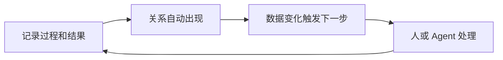

# dt 项目介绍

**dt 是一个给 Agent 用的动态表格。Agent 把干活的过程和结果记下来，人和别的 Agent 都能在同一处看见、接着用。**

它要解决的不是「再做一个表格」，而是三件常见的事：

| 常见问题 | dt 的做法 |
|---|---|
| Agent 干完活，结果散在临时目录、日志和聊天里 | 记进结构化的表，人和 Agent 实时看到同一份 |
| 多个 Agent 一起干，谁做了什么说不清 | 每条记录都留下操作者和修改痕迹 |
| 数据和数据之间的关系只存在某个人的脑子里 | 关系随记录自动出现，可以查、可以看、可以回放 |

---

## 一、四个能力

### 1. 动态表格：想记什么，就有什么表

Agent 不需要等人建库建表，自己就能定义「要存哪些信息」，并且随着工作推进不断调整。

- **表可以自己长**：先记任务，后来需要执行日志就加一张子表，日志下面还能再挂附件；需要引用别的表时直接连过去。
- **能记的东西齐全**：文本、数字、日期、选项、人员、文件和链接，常见的信息类型都覆盖。
- **人和 Agent 在同一张表上工作**：人在浏览器里看表格、看看板，直接改单元格；Agent 改完，页面很快把那一格标出来，并注明是谁改的。
- **不会互相覆盖**：两个人或两个 Agent 同时改一条记录时，会明确提示冲突，而不是悄悄丢掉一个人的修改。
- **文件只记位置，不复制**：Agent 的产出物放在哪，记录就指向哪；文件被移动或改动，页面会提示。
- **说明就写在结构里**：每张表、每个字段都可以写清楚是干什么用的，下一个 Agent 自己就能看懂。

一个空间（域）就是一个独立的协作单元，可以按项目、团队或业务线划分，互不干扰。

### 2. 知识图谱：关系不用另外建

**记录一写进去，关系就已经在了。** 不需要另建图数据库，也不用把数据导入导出。

记录和记录之间的关系会自动出现：

- 父子关系，比如任务下面挂着它的日志和附件；
- 引用关系，比如这条任务指向负责它的 Agent、它依赖的前置任务；
- 同值关系，比如不同表里出现同一个编号、同一个系统名，会自动认为说的是同一个东西；
- 操作关系，谁改过哪条记录，也能在图上看见。

有了图，可以直接回答这些问题：

| 想知道的 | 怎么看 |
|---|---|
| 这条记录关联了哪些东西？ | 从它出发看周边，按跳数或全部展开 |
| 两条记录是怎么连起来的？ | 找出它们之间的路径 |
| 谁依赖谁？哪些现在可以开始？ | 看依赖关系和已经完成的状态 |
| 哪些事可以同时做？ | 按依赖排出先后和可并行的层次 |
| 改一条、删一条会影响谁？ | 事先预览会连带影响的范围 |
| 数据里有没有断掉的引用、没人连的孤岛、绕不出去的循环？ | 一次检查全部列出来 |
| 谁连接最多、最忙？ | 按连接数排出枢纽 |
| 这张图以前长什么样？ | 拖动时间轴回放任意时刻 |

页面上还能直接把一条记录拖到另一条上建立关联；图可以导出成图片式的结构图，贴进文档或汇报里。

### 3. 事件绑定：数据一变，下一步自动发生

任何新增、修改、删除都可以成为一个信号。

- **可以指定条件**：哪张表、哪个字段、变成什么值的时候触发。
- **触发之后可以做四件事**：
  - 通知外部系统；
  - 执行一个本机任务；
  - 自动写回一条新记录；
  - 放进收件箱，等人处理。
- **带着说明走**：可以附一句提示词，告诉接收方「这条变化发生了，接下来该做什么」。
- **消息不丢**：按顺序投递，失败会自动重试，投递记录和失败原因都能查。
- **Agent 之间靠数据传话**：一个 Agent 写完，另一个 Agent 收到变化再接着做，不需要互相直连，也不怕漏。

### 4. 收件箱：需要人决定的事集中一处

不是所有事都该让机器自己决定。收件箱把「必须人拍板」的事项集中起来：

- 未读有提醒，可以只看未读、一键全部已读；
- 每条消息带着完整上下文，直接跳回原记录，处理时不用翻日志；
- 人处理完，Agent 接着往下走；
- 少数情况下同一条消息可能送达两次，按消息编号忽略重复即可，不会重复打扰。

---

## 二、使用场景

### 1. 多 Agent 共同协作

多个 Agent 并行干活时，最大的问题不是算力，而是**各自的信息不互通**：A 的产出在某个临时目录，B 不知道；C 改了状态，D 还在用旧值。

dt 作为团队的共享事实层：

- **一个空间，大家看同一份事实**。任务、产出、评审、日志都在里面。
- **谁做了什么清清楚楚**。每条记录有创建者和最后修改者，每次修改都有操作者和改了什么。
- **分工靠空间和身份约定**。比如编排类信息只让协调者写，业务结果让真正产出它的 Agent 写，写错地方会被明确拒绝。
- **产出物直接挂回记录**。不用复制、不用搬运，记录里就能找到文件。
- **人是其中一个角色**。人在页面上改状态、写结论，Agent 下一次读到的就是新值。
- **并发不会丢数据**。同时修改会提示冲突，而不是覆盖。

典型形态：协调 Agent 拆任务 → 多个执行 Agent 并行做 → 结果写回 → 协调 Agent 看关系和解锁下游 → 需要确认的事进收件箱找人。

### 2. 多个图工程，按事件驱动

- **一个项目一张图**。多个项目就是多个互不干扰的图工程，各有各的表和关系，可以同时推进。
- **图不是画出来的，是写出来的**。插入一条记录，节点和关系就出现了；填一个引用，边就连上了；不需要先设计图结构，也不需要额外的同步工作。
- **事件驱动图的生长**。数据变化触发下一步：通知下游、跑检查、写回新记录、找人确认。新记录又进入图，流水线就这样一段段长出来。
- **多个图工程之间靠事件传递**。一个图里发生的变化，可以通知另一个图或另一个系统，让它们接着处理；不需要彼此直接调用。
- **依赖关系可以直接用来安排顺序**。哪些现在能做、哪些在等前置、哪些可以并行，一看就知道。
- **影响可以提前预判**。改一条记录前先看会连带影响谁；出问题时可以顺着关系找回源头；还可以回放任意时刻的图，看它是怎么长成现在这样的。

需要说明的是：**dt 负责让过程可见、可查、可回放，不替代原来的调度系统**。调度仍以原系统为准，dt 是它的镜像和协作层。

### 3. 数据分析

所有过程数据都在同一处，所以可以直接回答跨任务、跨 Agent、跨时间的问题，而不是逐个翻文件：

- 最近跑了多少任务，成功、跳过、失败各多少？
- 哪个 Agent 承担最多？平均耗时多少？
- 哪些任务被打回过？原因集中在哪？
- 一次任务里，哪些环节本来可以并行，实际有没有并行起来？
- 某次调研最终选入了哪些内容？理由是什么？
- 哪些记录没人关联、哪些引用已经断了？

人可以自己在页面上筛选；Agent 可以直接查出来写周报、做复盘、生成汇报材料；图还能导出到文档里。整个过程也能回放，所以「为什么变成现在这样」同样有据可查。

---

## 三、实践场景

| 场景 | 怎么用 | 得到什么 |
|---|---|---|
| **多 Agent 内容生产** | 采集、评审、产出各阶段写进同一棵记录树，阶段之间用事件传递信号 | 一条能回放的流水线，随时知道卡在哪一环 |
| **多 Agent 任务编排的镜像** | 协调者记录任务拆解和运行情况，执行 Agent 记录业务结果 | 人和 Agent 都能看懂团队怎么干活、这次干出了什么 |
| **研发任务管理** | 一个项目一个空间：任务、子任务、日志、缺陷，依赖互相连起来 | 看板看进度，关系图看先后与并行，直接知道哪些能开工 |
| **调研与知识沉淀** | 一次调研一棵树：主题 → 来源 → 笔记 → 结论，结论和依据互相引用 | 每条结论都能顺着关系找到证据 |
| **故障排查与运维记录** | 告警、处理动作、影响范围都记下来；同一台机器、同一个系统的多次排查自动串起来 | 一眼看到同一问题的历史脉络，有变化自动通知 |
| **测试与评测** | 用例、运行、失败原因、日志文件分表记录 | 失败分布、回归情况、可复查的证据 |
| **人机审批与交接** | 需要人确认的事直接放进收件箱 | 人集中处理，不打断 Agent 主流程 |
| **Agent 运行可观测** | Agent 在关键节点记录进展，失败和重试都有痕迹 | 谁在忙、哪里卡住、消息有没有送达，一目了然 |
| **个人知识库 / Agent 记忆** | 一条记忆一条记录，相关的内容互相引用 | Agent 按说明检索，人按关系浏览 |
| **影响与溯源分析** | 改之前看影响范围，出问题后顺着关系找源头 | 改动有依据，问题能追到根 |

**真实案例：TEAMS 多 Agent 团队。** TEAMS 用文件管理调度，把执行过程镜像到 dt 的两个空间：一个记录团队怎么干活（Agent 花名册、流程模板、任务拆解、运行和打回记录），一个记录这次活干出了什么（检索到的实体、搜索方向、候选内容和评审结论）。一次快照里有 36 个 Agent、14 个流程模板、68 个任务批次、588 个任务、286 次运行；一次检索提取了 51 个实体、拆成 6 个方向、收集 83 篇候选、最终入选 66 篇。人看看板、表格、变化记录、关系图和收件箱；Agent 用同一份数据做展开、统计和汇总。数据是流程的副产品，不用事后补周报。

---

## 四、上手方式

- 本机启动后，浏览器打开就能用，不需要部署服务器、也不需要数据库运维；
- Agent 装上配套的技能包，就能自己建表、记数据、配事件、读收件箱；
- 人和 Agent 看到的始终是同一份数据，不需要导来导去。

## 五、适用边界

dt 是为**本机个人使用、以及本机上的多个 Agent 协作**设计的：

- 只在本机运行，适合个人和小团队的单机协作，不适合直接当成多人共享的在线服务；
- 不同空间之间互相隔离，关系和图不跨空间；
- 文件只记录位置，不代为保管文件本身；
- 不做公式和自动汇总，计算交给使用它的人或 Agent；
- 通知可能重复送达，接收方按消息编号忽略重复即可。

换来的是：一个文件存数据、一条命令启动、Agent 不需要复杂客户端、人和 Agent 看到的状态始终一致。

---

延伸阅读：[introduction.md](introduction.md)（完整能力说明与 TEAMS 案例） · [design.md](design.md)（数据模型与接口设计）
